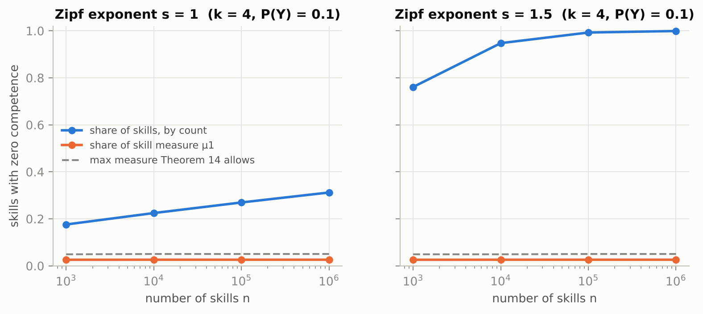
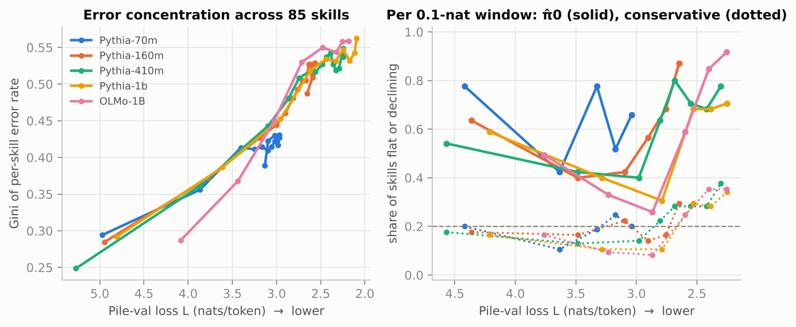
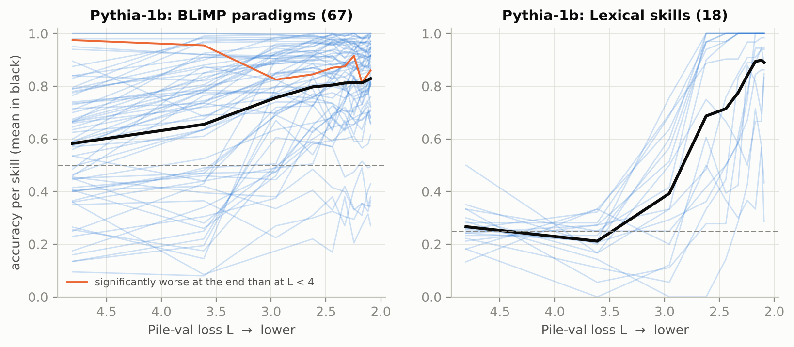
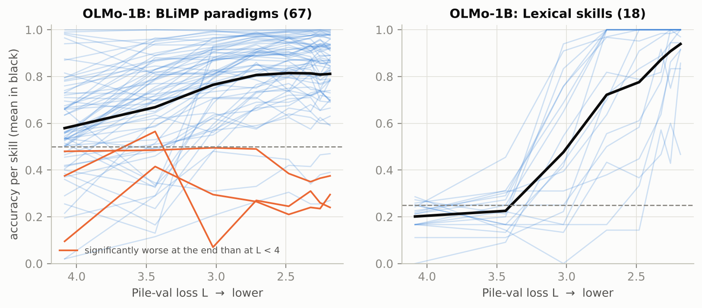
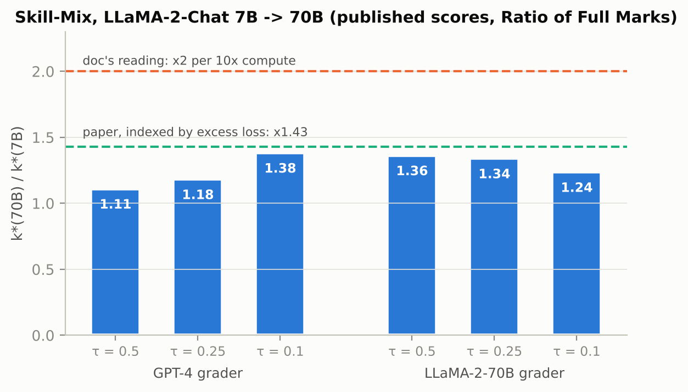
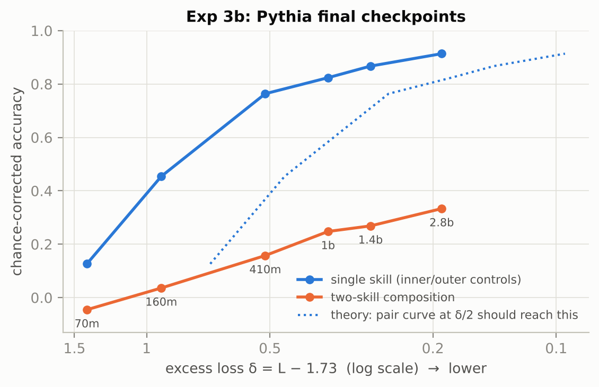
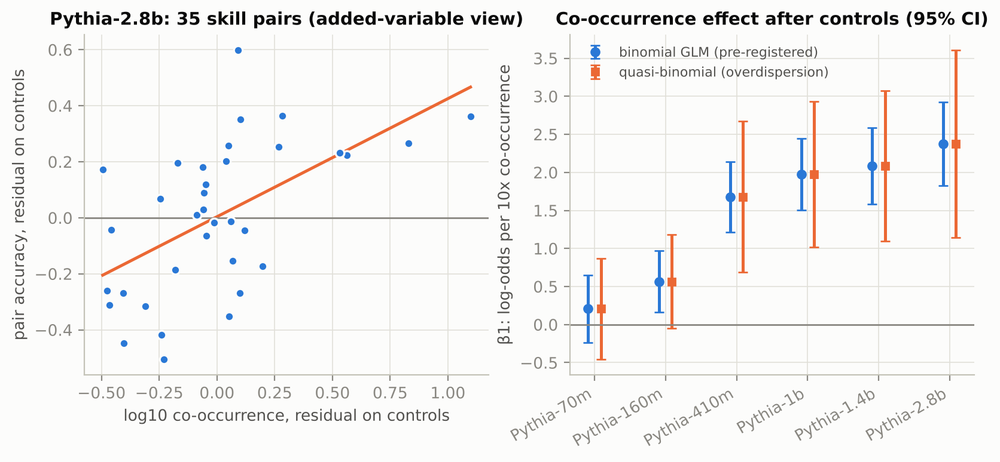

# Training-free falsification tests of the Arora–Goyal skill-graph theory: results

Design doc: "Falsifying the Arora–Goyal Skill-Graph Theory: Experimental Designs" (2026-11-17).
Paper: Arora & Goyal, "A Theory for Emergence of Complex Skills and Language Models",
arXiv:2307.15936. Constraint: no model training. Everything ran on a 4-core CPU.
Criteria and thresholds were fixed in `PREREGISTRATION.md` (commit `f8fb404`) before any
experiment ran. Anything added after seeing data is marked **exploratory**.

## Summary

| test | what it tests | pre-registered verdict | what it says about the theory |
| --- | --- | --- | --- |
| Formal check (§1) | The doc's Zipf counterexample against Theorem 14 | Consistent with Theorem 14 in all 72 configurations | Refutes only a count-weighted reading. Shows that the theorem says nothing about how many distinct skills a model has |
| Exp 2 (§2) | "Lower loss improves every skill" | R2a and R2b met in both families (all four Pythia models and OLMo-1B): **strong reading refuted** | Only 1–4 of 85 skills truly get worse over a run; most of the per-window "flat" share is gains too small to detect in one window. Not in conflict with Theorem 14 under a probe-error mapping. Takeaway 3 (frequent skills first) not supported |
| Exp 3 (§3) | k\* doubles per 10x compute (published Skill-Mix) | Point estimate below 0.5 doublings per decade in all 12 cells, whole bound interval below it in 5: **refuted** | The doubling rule assumes 10x in both N and D. The loss-indexed prediction (1.43x) is also missed in all 12 cells, by 0.05–0.43. Weak data |
| Exp 3b (§3b) | Halving excess loss lets pairs reach singles | 4 of 8 hold: **not refuted, by the narrowest margin**; refuted with E = 1.8 | Holds only when the smaller model is near chance; fails whenever it has real single-skill competence |
| Exp 4 (§4) | Pair competence does not depend on co-occurrence | R4a and R4b met, R4c narrowly missed at 2.8b | Moderate evidence against random k-tuple composition: pair competence rises with co-occurrence beyond single-skill frequency, and more so in larger models |
| Exp 1, Exp 4 on OLMo/Dolma | — | Not run | Exp 1 needs training; no Dolma index was set up |

**Bottom line.** No result contradicts the theorems as stated. They are measure-weighted,
they are lower bounds, and for small k or large θ they guarantee nothing. The descriptive
readings that the paper's text and the Skill-Mix paper invite fare worse:

- "every skill improves" fails, though only for a handful of skills;
- "10x scale doubles k\*" fails, even when scale is indexed by loss;
- "half the excess loss lets pairs catch up with singles" fails wherever it can be tested
  meaningfully;
- composition tracks the specific pair's co-occurrence.

The last result is the most direct evidence against the model's assumption that skills
combine in random k-tuples. It rests on a crude proxy and one corpus.

## 0. What the theory claims, and what can refute it

Reading the paper closely changed three things in the doc's plan. They were fixed before
any data was seen (`PREREGISTRATION.md` §0).

1. **The general theorem is about skill measure, not skill count (C1).** Theorem 14 (§6)
   says the µ1-*measure* of skills with at most βθ of their edges in the failure set Y is at
   least 1 − α. Only for uniform µ1 (§5, Theorem 8) does measure equal count. Takeaway 3
   says frequent skills become competent first. So "rare skills stall" is the paper's own
   prediction, not a refutation of it.
2. **The scaling statements are lower bounds (C2).** Corollary 13 and Takeaway 1 bound the
   guaranteed competence; the paper says actual gains could be higher. So only growth
   *slower* than predicted can count against them, and even then only if the bound is close
   to tight (see §3).
3. **The theorem is often vacuous (C3).** Its condition is k·θ·KL(βα‖α) > H(θ), where θ is
   the share of text pieces the model gets wrong. For k = 1 it never gives a bound. For
   k ≤ 8 and θ ≥ 0.5 it guarantees nothing on 80% of the skill measure.

As a result most of the tests below test a **strong, descriptive reading**: lower loss
improves every skill, and 10x scale doubles the number of composable skills. The paper's
text invites this reading, but its theorems do not assert it. Each section says which
reading it tests.

## 1. Formal check: the doc's Zipf counterexample

`formal/zipf_check.py` builds the doc's failure set Y exactly, with no union bound: all text
pieces that contain at least one skill ranked beyond a cut m, with m chosen so that P(Y) ≤ θ.
It checks 72 configurations: Zipf exponent s ∈ {1, 1.5}, n ∈ {10³, …, 10⁶} skills,
k ∈ {2, 4, 8}, θ ∈ {0.05, 0.1, 0.2}.

| s | n | k | θ | skills with zero competence, by count | …by measure µ1 | max measure Theorem 14 allows |
| --- | --- | --- | --- | --- | --- | --- |
| 1.0 | 10³ | 4 | 0.1 | 17.6% | 2.6% | 4.9% |
| 1.0 | 10⁶ | 4 | 0.1 | 31.2% | 2.6% | 5.0% |
| 1.5 | 10³ | 4 | 0.1 | 76.1% | 2.6% | 4.9% |
| 1.5 | 10⁶ | 4 | 0.1 | 99.9% | 2.6% | 5.0% |

- The doc's arithmetic is right: by count, the share of skills with zero competence grows
  with n, and reaches 99.9% for s = 1.5.
- Those skills carry only about 2.6% of the measure, below the largest share Theorem 14
  allows, in **all 72 configurations**. A Monte Carlo run on sampled graphs agrees: with
  s = 1.5, k = 4 and θ = 0.1, mean competence is 0.04 by count and 0.905 by measure.
- **Verdict: not a refutation of Theorem 14.** It refutes only a count-weighted reading,
  which the paper makes only for uniform µ1. It does mark a real limit: the theorem says
  nothing about how many *distinct* skills a model has. Under a heavy-tailed µ1 almost all
  skills can be absent while the theorem holds.

Vacuity, i.e. the competence the theorem guarantees on 80% / 50% of the skill measure
(from `results/formal_zipf_check.json`):

| k | θ = 0.1 | θ = 0.3 | θ = 0.5 |
| --- | --- | --- | --- |
| 1 | 0 / 0 | 0 / 0 | 0 / 0 |
| 2 | 0.44 / 0.44 | 0 / 0.14 | 0 / 0 |
| 4 | 0.60 / 0.77 | 0.00 / 0.43 | 0 / 0.11 |
| 8 | 0.69 / 0.82 | 0.22 / 0.50 | 0 / 0.21 |

## 2. Experiment 2: does lower loss improve every skill?

**Setup** (`PREREGISTRATION.md` §2).
- Checkpoints:
  - Pythia 70m, 160m, 410m: 15 each.
  - Pythia 1b: 10.
  - OLMo-1B: 8, from 4B to 3T tokens.
  - Pythia 1.4b and 2.8b: final checkpoints only, as extra points across sizes.
- 85 skills:
  - The 67 BLiMP paradigms, 200 minimal pairs each.
  - The 18 lexical skills from Exp 4, as single-skill cloze items.
- L: mean next-token loss on 200 Pile-validation documents.
- Windows: a window runs from one checkpoint to the first later one whose L is at least
  0.10 nats lower; the next window starts there.
- Per window:
  - F_π0, the primary statistic: Storey's π̂0 on one-sided paired tests. It estimates the
    share of skills that did not truly improve.
  - F_cons: the share of skills whose 95% bootstrap upper bound on Δaccuracy is below
    +0.02.
  - The number of skills whose whole 95% interval for Δaccuracy is below zero.
- Per checkpoint: the Gini of the per-skill error rates.

| model | checkpoints | windows | L, first → final | F_π0 per window | windows with F_π0 > 0.2 | F_cons per window | skills with CI below 0, per window | ρ(L, Gini), L < 4 | R2a | R2b |
| --- | --- | --- | --- | --- | --- | --- | --- | --- | --- | --- |
| Pythia-70m | 15 | 5 | 4.97 → 3.13 | 0.42–0.78 | 5 of 5 | 0.11–0.25 | 2–10 | −0.82 | holds | holds |
| Pythia-160m | 15 | 6 | 4.95 → 2.65 | 0.40–0.87 | 6 of 6 | 0.14–0.29 | 3–10 | −0.93 | holds | holds |
| Pythia-410m | 15 | 8 | 5.27 → 2.25 | 0.40–0.80 | 8 of 8 | 0.13–0.38 | 4–9 | −0.84 | holds | holds |
| Pythia-1b | 10 | 6 | 4.81 → 2.09 | 0.31–0.71 | 6 of 6 | 0.11–0.34 | 2–10 | −0.88 | holds | holds |
| OLMo-1B | 8 | 6 | 4.09 → 2.18 | 0.26–0.92 | 6 of 6 | 0.08–0.35 | 0–10 | −0.96 | holds | holds |

Pre-registered verdicts (the doc's "lower loss improves every skill" reading):

- **R2a** (F_π0 > 0.20 in at least half of a model's windows, in both families):
  **met in both families**, in every model.
- **R2b** (ρ(L, Gini) < −0.5 over checkpoints with L < 4.0, in both families):
  **met in both families**, in every model. The chance-normalised Gini, the share of
  errors on the worst 10% of skills, and the Gini over BLiMP paradigms alone all point the
  same way. Across the final checkpoints of all six Pythia sizes, ρ(L, Gini) = −0.83.

By the pre-registered rule, the strong reading is refuted. How strong that refutation is
depends on which statistic you use:

- **π̂0 overstates how many skills are flat.** It counts every skill without a
  *detectable* gain. With 200 items per skill and windows of 0.1–0.2 nats, small real
  gains are often undetectable. Even in each Pythia model's first window, where L falls
  1.1–1.4 nats, π̂0 is 0.54–0.78. On the conservative F_cons, the criterion would hold in
  at least half the windows only for Pythia-410m (5 of 8), Pythia-1b (3 of 6) and OLMo-1B
  (3 of 6), not for 70m (1 of 5) or 160m (2 of 6).
- **Per-window declines are partly chance.** With 85 skills, about 2 intervals per window
  would fall below zero by chance even if nothing changed. The observed 0–10 (mean 6.0 over
  31 windows) is more than that, but not by much.
- **Exploratory net-change check** (added after seeing the window results). This compares
  each skill at the first checkpoint with L < 4 against the final checkpoint, using an
  exact McNemar test with Benjamini–Hochberg correction across the 85 skills:

  | model | L, from → to | significantly worse | significantly better | Δaccuracy ≤ +0.02 | skills that got worse |
  | --- | --- | --- | --- | --- | --- |
  | Pythia-70m | 3.86 → 3.13 | 3 | 36 | 22 | principle_A_reconstruction (0.40 → 0.18), wh_questions_subject_gap_long_distance, irregular_past_participle_adjectives |
  | Pythia-160m | 3.78 → 2.65 | 4 | 53 | 20 | principle_A_reconstruction (0.49 → 0.12), irregular_past_participle_adjectives, wh_questions_subject_gap_long_distance, only_npi_scope |
  | Pythia-410m | 3.87 → 2.25 | 1 | 69 | 11 | principle_A_reconstruction (0.52 → 0.35) |
  | Pythia-1b | 3.61 → 2.09 | 1 | 62 | 10 | wh_questions_subject_gap_long_distance (0.96 → 0.86) |
  | OLMo-1B | 3.44 → 2.18 | 3 | 62 | 10 | principle_A_reconstruction (0.57 → 0.24), existential_there_quantifiers_2 (0.42 → 0.30), sentential_subject_island (0.49 → 0.38) |

  OLMo's first checkpoint below L = 4 comes at 8B tokens, with L = 3.44. Over the whole
  run a few skills really do get worse as loss falls. All of them are BLiMP paradigms,
  and several end below chance. principle_A_reconstruction drops in four of the five
  models. Larger models improve on more skills: 36 at 70m, and 53–69 from 160m up. So
  "every skill improves" fails, but only for 1–4 of 85 skills. Another 10–22 skills
  change by at most +0.02 over the run, and 2–7 of those started at 0.95 or above. The
  large per-window "flat" shares mostly reflect gains too small to detect within one
  window.
- **Errors concentrate as loss falls.** Gini rises from 0.36–0.39 at the first checkpoint
  with L < 4 to 0.39–0.56 at the final checkpoints. Mean error falls, but the remaining
  errors sit on fewer skills.
  - For Pythia-410m, Pythia-1b and OLMo-1B, the worst skills are a few BLiMP paradigms at
    or below chance: existential_there_quantifiers_2 (0.27–0.30),
    principle_A_reconstruction, wh_vs_that_with_gap_long_distance and
    sentential_subject_island.
  - They also include one or two lexical skills the model has not learned (last_letter,
    plus next_day in Pythia).
- **BLiMP saturates while loss keeps falling.** In OLMo-1B, mean BLiMP accuracy stays at
  0.81 from 41B to 3T tokens while L falls by 0.53 nats (2.71 → 2.18). Over the same
  stretch, lexical accuracy rises from 0.72 to 0.94. Late loss reductions buy almost no
  grammatical competence on these probes.
- **Pythia 70m and 160m lose ground late in training.** L reaches its minimum at step
  48000 (70m, 2.97) and step 66000 (160m, 2.57), then rises to 3.13 and 2.65 by step
  143000. Windows are defined by falling L, so this stretch is in no window.

Checks on the theory itself rather than the strong reading:

- **Frequency weighting (C1).** For the 18 lexical skills, weighting each skill by its
  corpus cue frequency instead of counting skills equally barely moves the window
  statistics (mean F_cons 0.16–0.26 by frequency vs 0.17–0.27 by count). With an
  effective sample of about 9 skills this is too noisy to separate the two readings.
- **Theorem 14 envelope** (exploratory). Read each skill's probe error rate as its share
  of failing edges, and assume uniform µ1 over the 85 skills. Theorem 14 then says that at
  most a share α of skills can fall below a competence bound set by k, θ and α. With θ set
  to the mean per-skill error, which is the theorem's own averaging identity, the bound is
  non-trivial at 58 of 60 checkpoint × k combinations (k ∈ {2, 4, 8, 16}; 38 of 40 for
  Pythia-1b, 31 of 32 for OLMo-1B) and is never violated, in any model. I first tried
  θ = item-level error rate, which weights BLiMP more heavily. With that choice the only
  violations are at k = 16, by 1–8 skills. Both versions are reported because the second
  was chosen after the first was seen. On this mapping the data are consistent with the
  theorem.
- **Takeaway 3, a prediction rather than a refutation test.** The paper predicts that more
  frequent skills reach a given competence at higher loss. For the 18 lexical skills, the
  effect of log cue frequency at the median L is −0.05 to −0.10 (SE 0.07–0.12) in every
  Pythia model. The rank correlation between frequency and final accuracy is −0.21 to
  −0.32 (all p > 0.19). In OLMo-1B the effect is −0.03 (SE 0.06) and the correlation
  +0.01, though its frequencies come from the Pile, not OLMo's own Dolma corpus. **The
  prediction is not supported.** With 18 skills whose difficulty differs a lot
  (letter-level tasks are hard for BPE models whatever their frequency), and cue counts as
  a rough proxy for µ1, this is weak evidence against it.

**Verdict.** Under the pre-registered criteria, the strong descriptive reading ("lower loss
improves every skill") is refuted in both families. The refutation rests on 1–4 skills per
model that truly decline, plus many skills whose gains are too small to detect, and it is
weaker on the conservative statistic. None of this contradicts Theorem 14 under the
mapping above. The paper's Takeaway 3 prediction gets no support from the lexical skills.

## 3. Experiment 3: Skill-Mix scaling, from the published tables

There was no new generation, since there is no grader API and no GPU. The data are Yu et
al. (2023), Tables 1 (GPT-4 grader) and 2 (LLaMA-2-70B grader), for LLaMA-2-{7, 70}B-Chat.
Both models were trained on 2T tokens, so 7B → 70B is 10x compute. k\* is the largest k
whose score is at least τ, linearly interpolated; cells the paper skipped are bounded.

| grader | metric | τ | k\*(7B) | k\*(70B) | ratio | doublings per decade | bounds from skipped cells |
| --- | --- | --- | --- | --- | --- | --- | --- |
| GPT-4 | full marks | 0.5 | 1.53 | 1.69 | 1.11 | 0.15 | [−0.61, 0.76] |
| GPT-4 | full marks | 0.25 | 1.79 | 2.12 | 1.18 | 0.24 | [0.24, 1.08] |
| GPT-4 | full marks | 0.1 | 1.95 | 2.69 | 1.38 | 0.47 | [0.47, 1.43] |
| GPT-4 | all skills | 0.5 | 1.56 | 1.69 | 1.08 | 0.12 | [−0.64, 0.76] |
| GPT-4 | all skills | 0.25 | 1.84 | 2.13 | 1.16 | 0.21 | [0.21, 1.09] |
| GPT-4 | all skills | 0.1 | 2.10 | 2.78 | 1.33 | 0.41 | [0.41, 0.41] |
| LLaMA-2-70B | full marks | 0.5 | 2.15 | 2.93 | 1.36 | 0.45 | [0.45, 0.45] |
| LLaMA-2-70B | full marks | 0.25 | 3.40 | 4.56 | 1.34 | 0.42 | [0.42, 0.42] |
| LLaMA-2-70B | full marks | 0.1 | 4.23 | 5.23 | 1.24 | 0.31 | [0.07, 0.50] |
| LLaMA-2-70B | all skills | 0.5 | 3.00 | 3.00 | 1.00 | 0.00 | [0.00, 0.00] |
| LLaMA-2-70B | all skills | 0.25 | 3.68 | 4.92 | 1.34 | 0.42 | [0.42, 0.42] |
| LLaMA-2-70B | all skills | 0.1 | 4.23 | 5.57 | 1.32 | 0.40 | [0.15, 0.50] |

- **The doc's reading (k\* doubles per 10x compute) fails.** All 12 point estimates are
  below the pre-registered refutation threshold of 0.5 doublings per decade. In 5 of 12
  cells the whole bound interval is below it too.
- **That reading overstates the paper.** §2.1 of the paper says excess loss halves when N
  *and* D both grow 10x, which is 100x compute. LLaMA-2 7B → 70B kept D fixed. With the
  Chinchilla fit (E = 1.69, A = 406.4, B = 410.7, α = 0.34, β = 0.28), that step cuts excess
  loss by only 1.43x. Indexed by excess loss, Corollary 13 then predicts a k\* ratio of
  1.43, or 0.52 doublings. A compute-optimal 10x would also give only 1.42x. *Disclosure:
  I noticed this after computing the k\* ratios. The pre-registration fixed the doubling
  rule.*
- Against 1.43, the observed ratios (1.00–1.38) still fall short in all 12 cells, but by
  0.05–0.43. In 5 of 12 cells the bounds from skipped cells reach the loss-indexed rate.
- Corollary 13 bounds the *guaranteed* competence curve. Actual k\* can grow more slowly
  than the guarantee whenever the smaller model already beats its guarantee. So even a
  clear shortfall would contradict only the descriptive reading. The Skill-Mix paper itself
  uses that reading.
- **Strength: weak.** One family, chat-tuned models, small per-cell samples, and results
  that depend on the grader (the LLaMA-2 grader gives 1.4–2.2x the k\* of GPT-4).

## 3b. Experiment 3b: does halving excess loss let pairs catch up with singles?

This uses our own cloze data instead of Skill-Mix, and indexes scale by loss instead of
compute. I fit L(N) = E + A·N^(−a) on the six Pythia final checkpoints, which gives
E = 1.73. Then δ = L − E. For every model pair (M1, M2) with δ(M2) ≤ δ(M1)/2, the
descriptive reading of Corollary 13 predicts that M2's chance-corrected accuracy on
two-skill compositions is at least M1's chance-corrected accuracy on the single skills.

| Pythia | L | δ = L − 1.73 | single skills (chance-corrected) | two-skill pairs (chance-corrected) |
| --- | --- | --- | --- | --- |
| 70m | 3.131 | 1.40 | 0.13 | −0.05 |
| 160m | 2.653 | 0.92 | 0.45 | +0.04 |
| 410m | 2.246 | 0.51 | 0.76 | +0.16 |
| 1b | 2.093 | 0.36 | 0.82 | +0.25 |
| 1.4b | 2.016 | 0.28 | 0.87 | +0.27 |
| 2.8b | 1.923 | 0.19 | 0.91 | +0.33 |

- Eight model pairs qualify. The prediction holds in 4 and fails in 4. The pre-registered
  rule refutes only if a *majority* fail, so **by the letter it is not refuted, at the
  narrowest possible margin**. It is not refuted with E = 1.6 either (4 of 7 hold), and it
  is refuted with E = 1.8 (4 of 10 hold).
- The split is systematic. The prediction holds in all four pairs where M1 is 70m, whose
  single-skill accuracy is close to chance, so the bar is almost zero. It fails in every
  pair where M1 has real single-skill competence (160m, 410m, 1b). For example, 2.8b has
  4.8x less excess loss than 160m, yet its pair accuracy (0.33) is well below 160m's
  single-skill accuracy (0.45). Composition improves steadily with scale but lags far
  behind what the descriptive reading predicts.
- Caveats:
  - The fit rests on six points.
  - Pythia 70m and 160m lose ground late in training (§2), which inflates their δ.
  - As in §3, Corollary 13 is about the guaranteed curve, so this tests the descriptive
    reading only.

## 4. Experiment 4: does pair competence track co-occurrence in the training data?

**Setup.**
- Items:
  - 35 two-skill compositions outer(inner(x)) over 18 checkable lexical skills, for
    example "the first letter of the capital of France".
  - Each is a 4-option, 3-shot cloze item, with 7–33 items per pair (818 in total).
  - Each pair has two controls: inner(x) alone, and outer(y) with y = inner(x) given.
- Frequencies, from Pile train via the infini-gram API:
  - f(s) counts a skill's cue phrases;
  - f12 counts the two skills' cues occurring within 100 tokens of each other.
- Models: the six Pythia final checkpoints, all trained on the Pile.
- Primary model: a pair-level binomial GLM with log10(f12 + 1), log10 f1, log10 f2,
  c_inner and c_outer as predictors.

| Pythia | params | L | inner | outer | pair | β1 [95% CI] (pre-reg.) | quasi-binomial p | permutation p | low − high tercile [95% CI] | ρ(acc, f12) raw | errors that skip the inner step |
| --- | --- | --- | --- | --- | --- | --- | --- | --- | --- | --- | --- |
| 70m | 70M | 3.131 | 0.33 | 0.36 | 0.22 | +0.21 [−0.24, +0.65] | 0.54 | 0.64 | +0.00 [−0.08, +0.09] | −0.44 | 39% |
| 160m | 162M | 2.653 | 0.58 | 0.60 | 0.28 | +0.57 [+0.16, +0.97] | 0.07 | 0.16 | −0.06 [−0.15, +0.02] | −0.23 | 48% |
| 410m | 405M | 2.246 | 0.87 | 0.77 | 0.37 | +1.68 [+1.22, +2.14] | 0.001 | 0.009 | −0.19 [−0.33, −0.04] | −0.14 | 70% |
| 1b | 1.0B | 2.093 | 0.91 | 0.82 | 0.44 | +1.98 [+1.51, +2.45] | <0.001 | <0.001 | −0.19 [−0.36, −0.01] | −0.02 | 65% |
| 1.4b | 1.4B | 2.016 | 0.96 | 0.85 | 0.45 | +2.09 [+1.58, +2.59] | <0.001 | <0.001 | −0.17 [−0.34, +0.00] | +0.18 | 74% |
| 2.8b | 2.8B | 1.923 | 0.99 | 0.88 | 0.50 | +2.37 [+1.83, +2.92] | <0.001 | 0.001 | −0.18 [−0.36, +0.02] | +0.28 | 66% |

Pre-registered verdicts at the largest size (2.8b):

- **R4a (β1 > 0, p < 0.05): met.** β1 = +2.37 log-odds per 10x co-occurrence.
- **R4b (β1 does not shrink with size): met.** The slope of β1 on log10 parameters is
  +1.43 (p < 0.001), and β1 rises at every step from 70m to 2.8b.
- **R4c (low-co-occurrence tercile below high, after controls): narrowly missed** at 2.8b,
  where the CI reaches +0.02. It is met at 410m and 1b.
- **Pre-registered secondary model:** the item-level logit with pair-clustered errors
  agrees (2.8b: +2.15, 95% CI +1.04 to +3.26).

Exploratory checks, added after seeing the numbers:

- The pair-level data are overdispersed (Pearson χ²/df = 3.9–5.1 from 410m up). With
  quasi-binomial errors, β1 stays significant from 410m up (p ≤ 0.001).
- A Freedman–Lane permutation test agrees (p ≤ 0.009 from 410m up).
- From 410m up, dropping all pairs that use any one of the 18 skills never changes the
  sign. At 1.4b and 2.8b it never removes significance.

Limits on interpretation:

- **The effect is conditional.** Raw ρ(pair accuracy, f12) runs from −0.44 to +0.28.
  Co-occurrence correlates strongly with the single-skill frequencies (ρ = 0.78). β1
  measures co-occurrence *beyond* what those frequencies predict, which is close to the
  PMI of the two cue sets.
- **The magnitude depends on how co-occurrence is counted.** The pre-registration did not
  fix the engine's `max_clause_freq`. At the default of 50k, AND counts are approximate and
  10 of 35 are zero. I re-queried at the API maximum of 500k when collecting counts, before
  any Exp 4 regression was run, and used that as primary. With the default counts, β1 has
  the same sign but is about 10x smaller (2.8b: +0.17, p = 0.03), peaks at 1b, and its
  slope on size is +0.22 (p = 0.21).
- Cue co-occurrence is a crude stand-in for "texts that use both skills". It may also track
  how natural or semantically related a composition is.
- Scale is small: 35 pairs, one corpus, CPU-scale models up to 2.8B.

How the models fail: from 410m up, 65–74% of wrong answers on pairs are outer(x), the
answer you get by skipping the inner step. That option makes up only 22% of all
distractors; it appears in 67% of items. Answers that stop at the intermediate inner(x)
are 2–6% (10% of distractors). The rest (23–33%) are unrelated distractors.
The models usually have both skills (inner 0.87–0.99, outer 0.77–0.88) but do not chain
them.

**Verdict.** At the largest size, two of three pre-registered criteria are met, and the
third misses narrowly. Beyond what single-skill frequency and competence explain, pair
competence rises with how often the two skills' cues occur together, and the effect grows
with scale. The skill-graph model assumes skills combine in random k-tuples, which leaves
no room for a pair-specific effect, so this result runs against it. Because the
co-occurrence proxy is crude and the effect size depends on how counts are taken, this is
moderate evidence, not decisive.

## Caveats

- **Scale.** Everything ran on a 4-core CPU: Pythia up to 2.8B and OLMo-1B, at most 200
  items per skill. Nothing here speaks to frontier-scale models.
- **Probes stand in for the theory's skills.** The theory's competence is the share of a
  skill's text pieces (edges) the model handles. BLiMP paradigms and cloze items measure
  something narrower. The Theorem 14 envelope in §2 depends on that mapping.
- **π̂0 at low power.** π̂0 counts every skill without a detectable gain, so it is biased
  upward when the test has little power. F_cons and the net-change check are reported next
  to it.
- **Vacuity and looseness.** For k = 1, or θ ≥ 0.5 with k ≤ 8, the theorem guarantees
  nothing on 80% of the measure (§1). In our probes the mean per-skill error runs from
  0.16 to 0.50. The bound in §2 is vacuous only at k = 2 for the first one or two
  checkpoints, but it is loose elsewhere, so "consistent with Theorem 14" is a weak
  statement.
- **OLMo's loss** is measured on Pile validation, not on its own training distribution.
  The pre-registration chose this shared held-out corpus. So OLMo's L values are not
  directly comparable with Pythia's.
- **Exp 4 measurement.**
  - Co-occurrence comes from cue phrases, over 35 pairs, in one corpus (Pile).
  - Effect size depends on the infini-gram `max_clause_freq`, which the pre-registration
    did not fix. Both settings are reported.
  - The share of errors that skip the inner step is post hoc.
- **Exp 3** uses published numbers only: one model family, chat-tuned, scored by two
  graders that disagree by 1.4–2.2x.
- **Pilot.** One pilot run (Pythia-160m, final checkpoint) was seen before the
  pre-registration was committed, to check the pipeline and timing. The only change made
  afterwards was cutting the Pile-val sample from 400 to 200 documents, for compute.
- **Post hoc analyses.** Everything marked *exploratory* was added after seeing data:
  - Exp 2: the net-change check and the Theorem 14 envelope, including the second choice
    of θ.
  - Exp 3: the loss-indexed reading.
  - Exp 4: quasi-binomial errors, the permutation test, leave-one-skill-out, and the error
    breakdown.
- **Not run.** Exp 1 (it needs training) and the OLMo/Dolma arm of Exp 4. So the
  two-corpus replication the doc asks for is missing.
